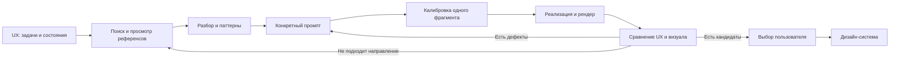

# Product UI Workbench

Навык для Codex и Claude Code: найти и разобрать интерфейсы, сохранить полезные паттерны, перевести их в конкретный промпт и улучшать дизайн по настоящим рендерам.

Подходит для дашбордов, CRM, админок, каталогов и исследований компонентов. Помогает создать оригинальный интерфейс, объяснить решения и проверить доступные состояния. После выбора направления можно собрать дизайн-систему.

## Как работает



Для изменения материалов или цветов уже согласованного экрана повторное UX-интервью не требуется. Для нового сложного сценария сначала сравниваются разные способы выполнить задачу. Смоделированные интервью всегда помечаются как гипотезы.

## Что нужно

| Возможность | Требования |
|---|---|
| Работа по инструкциям навыка | Codex или Claude Code; просмотр изображений для визуальной оценки |
| Поиск референсов | Браузер или доступный поиск; можно передать свои скриншоты |
| Учет паттернов, проверка JSON, упаковка через CLI | Python 3.10+; стандартная библиотека |
| Автоматические веб-снимки и интерактивные проверки | Python Playwright и установленный Chrome; подключаются отдельно |
| React / shadcn | Совместимый проект и его зависимости, если выбран этот стек |
| Mobbin, Figma и другие коннекторы | Необязательны; нужны доступ и авторизация только для выбранного сервиса |

Установка навыка не устанавливает браузеры, Node.js, React, пакеты или MCP-серверы. Встроенный поиск библиотеки работает локально. У нативных компонентов нет требования Node.js; у React-компонентов есть собственные зависимости.

Подробно: [зависимости и необязательный браузер](docs/DEPENDENCIES.md). [Официальные системы и источники для нового поиска](docs/REFERENCES.md).

## Установка

Нужен Git. Клонируйте **весь репозиторий**: одного `SKILL.md` недостаточно, он использует соседние файлы.

### Codex

PowerShell:

```powershell
New-Item -ItemType Directory -Force "$HOME/.agents/skills" | Out-Null
git clone https://github.com/pavvelltour-web/product-ui-workbench.git "$HOME/.agents/skills/product-ui-workbench"
```

macOS / Linux:

```bash
mkdir -p ~/.agents/skills
git clone https://github.com/pavvelltour-web/product-ui-workbench.git ~/.agents/skills/product-ui-workbench
```

### Claude Code

PowerShell:

```powershell
New-Item -ItemType Directory -Force "$HOME/.claude/skills" | Out-Null
git clone https://github.com/pavvelltour-web/product-ui-workbench.git "$HOME/.claude/skills/product-ui-workbench"
```

macOS / Linux:

```bash
mkdir -p ~/.claude/skills
git clone https://github.com/pavvelltour-web/product-ui-workbench.git ~/.claude/skills/product-ui-workbench
```

Если целевая папка уже есть, сначала проверьте ее содержимое. Не клонируйте поверх своей измененной копии. Обнаружение навыков зависит от клиента; после установки откройте новый чат и проверьте список навыков. Официальные инструкции: [Codex](https://learn.chatgpt.com/docs/build-skills), [Claude Code](https://code.claude.com/docs/en/skills).

### Из скачанного архива или отдельного клона

Скачайте пакет со страницы [Releases](https://github.com/pavvelltour-web/product-ui-workbench/releases), распакуйте и перейдите в его корень. С Python 3.10+ можно сначала увидеть план, затем скопировать весь навык:

```bash
python scripts/install.py --host codex --dry-run
python scripts/install.py --host codex
```

Для Claude Code замените `codex` на `claude`. Для одного проекта используйте `--project` с путем к существующему проекту; для своего каталога — `--destination` с путем к новой папке навыка. Скрипт откажется перезаписывать существующую папку и не меняет настройки агента, зависимости и другие проекты.

Обновление установленного через Git навыка: проверьте свои изменения и выполните `git pull --ff-only` внутри его папки. Для копии из архива сохраните старую папку под другим именем и установите новую. Не оставляйте две одноименные версии в каталогах обнаружения навыков.

## Первый запуск

В Codex вызовите `$product-ui-workbench`, в Claude Code — `/product-ui-workbench`. Затем опишите результат и ограничения:

```text
Сделай 3 разных направления админки для управления ИИ-агентами.
Основные задачи: найти ошибку запуска, изучить результат, согласовать действие.
Нужны desktop и mobile, темная тема, выразительный зеленый акцент.
Начни с UX, затем найди и реально просмотри референсы, разбери их,
сохрани паттерны и составь промпт до реализации.
Покажи PNG, объясни отличия и ограничения каждого кандидата.
Не строй дизайн-систему до моего выбора. Бэкенд не нужен.
```

Можно начать с готового экрана:

```text
Сохрани текущие задачи, данные и порядок действий.
По прикрепленным референсам сделай 2 новых визуальных направления.
Сначала объясни композицию, шрифты, отступы, роли цвета и компоненты.
Проверь небольшой фрагмент, затем целый экран и открытые состояния.
Сравни новые PNG с исходным экраном, не ограничивайся сменой палитры.
```

Подробные сценарии: [как пользоваться](docs/USAGE.md).

## Если нет Mobbin и библиотек

Начните с публичных экранов продуктов, документации и демо. Pinterest, X, Dribbble и Behance помогают искать направление; затем по возможности найдите оригинальную страницу автора или продукта. Сохраненная ссылка без просмотренного изображения не считается разобранным референсом.

Если агент не может открыть страницу из-за входа или ограничений, откройте ее сами и передайте скриншот. Навык может работать с этими файлами без коннектора. Не передавайте пароли, cookies и токены.

Отсутствие компонентной библиотеки допускает реализацию на HTML/CSS или локальных компонентах. Если задача прямо требует shadcn, нужна настоящая совместимая реализация; похожие кнопки нельзя выдавать за подключенную библиотеку.

Пошагово, с поисковыми запросами и источниками: [поиск референсов без платных сервисов](docs/REFERENCE_SEARCH.md).

## Что находится в репозитории

```text
SKILL.md       Инструкции агенту и выбор нужной ветки работы
references/    Разбор референсов, UX, материалы, темы, проверки
library/       Небольшая исходная библиотека и контекстные паттерны
scripts/       Необязательные инструменты учета, рендера и проверки
schemas/       Контракты данных для инструментов
tests/         Проверки инструментов и локальные примеры
docs/          Руководства для пользователя и точный API
```

Библиотека — отправная точка, а не каталог всех интерфейсов. Происхождение и лицензии компонентов указаны рядом с исходниками. Сам факт наличия компонента не доказывает, что он корректно работает в новом приложении.

## Команды для инструментов

Обычный запуск навыка не требует CLI. Команды ниже выполняйте из папки репозитория. Создайте отдельную рабочую папку `workbench-run` вне установленного навыка; вместо примера пути подставьте свой существующий каталог.

```bash
python scripts/pipeline.py --workspace /path/to/workbench-run --help
python scripts/pipeline.py --workspace /path/to/workbench-run library-search "queue detail" --type pattern --limit 5
python -m unittest discover -s tests -v
```

В Windows замените путь на, например, `C:/work/workbench-run`; команда Python зависит от вашей установки (`python`, `python3` или `py -3`). Браузерные тесты требуют отдельного окружения, указанного выше.

Строгий CLI хранит историю, связывает промпты, исходники и снимки, проверяет свежесть файлов. Он **не вызывает модель, не ищет референсы и не оценивает красоту автоматически**. Форматы входных JSON и точные команды: [API](docs/API.md).

### Локальный пример

```bash
python scripts/demo.py --workspace /path/to/new-workbench-demo
```

Команда создает собственный автономный пример интерфейса и манифест в новой папке. Для снимков добавьте `--chrome` с полным путем к установленному Chrome; потребуется Python Playwright. Пример показывает работу инструментов, не выдает автоматическую оценку визуального качества. В Windows используйте свой путь, например `C:/work/new-workbench-demo`.

Для просмотра запустите локальный HTTP-сервер, указав тот же каталог примера:

```bash
python -m http.server 4173 --bind 127.0.0.1 --directory /path/to/new-workbench-demo/generated/demo
```

Откройте `http://127.0.0.1:4173`. Прямое открытие HTML через `file://` не подходит: пример использует ES-модули.

В демо есть готовый план `research/ux-plan.json`. С установленным Playwright можно проверить нативный Select, точную запись, Escape и возврат фокуса:

```bash
python scripts/browser_probe.py --workspace /path/to/new-workbench-demo --source-manifest inputs/build.json --plan research/ux-plan.json --out images/check-1 --chrome /absolute/path/to/chrome
```

## Что считается готовым

- Референсы действительно просмотрены, наблюдения отделены от предположений.
- Промпт объясняет композицию, типографику, отступы, цвет, материалы и адаптацию.
- Сравниваются настоящие PNG актуальной реализации, включая мобильный экран.
- Важные действия, фильтры, открытые панели, ошибки и возврат фокуса проверены в доступном окружении.
- Для каждого кандидата названы сильная сторона, компромисс и оставшиеся ограничения.
- Выбор пользователя записан отдельно от технического прохождения проверок.

Проверки браузера не заменяют исследование с людьми, полный аудит доступности или тест на физическом телефоне. Для проверки без браузера агент явно перечисляет непроверенные состояния.

## После выбора

Попросите выделить токены и компоненты из согласованного направления, собрать состояния и показать несколько разных экранов на одной системе. Порядок работы: [из кандидатов в дизайн-систему](docs/DESIGN_SYSTEM.md).

Рабочие экраны, данные клиентов и приватные референсы храните в отдельном проекте. Перед публикацией своего форка проверьте файлы и историю Git: публичный репозиторий навыка не должен становиться архивом пользовательских проектов.
