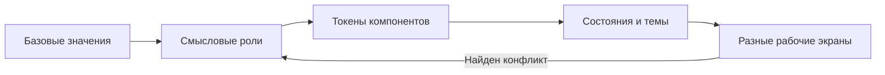

# От кандидатов к дизайн-системе

Сначала выбирают работающее направление, затем выделяют систему. Несогласованные варианты можно хранить для сравнения, но их случайная смесь даст конфликтующие размеры, акценты и состояния.

## 1. Зафиксируйте выбор

Запишите конкретно:

```text
Основа: композиция выбранного кандидата.
Переносим: типографику второго кандидата и его компактные фильтры.
Не переносим: второстепенную диаграмму и декоративные метрики.
Сохраняем: согласованные задачи, данные, мобильный порядок и область фильтров.
Проверяем снова: открытый Select, панель детали и контраст акцентной кнопки.
```

Если выбор объединяет разные варианты, сначала согласуйте один собранный экран. «Возьми лучшее из всех» не задает проверяемую систему.

## 2. Выделите три слоя токенов



| Слой | Пример | Для чего |
|---|---|---|
| Базовый | `green-400`, `space-4`, размер 14 | Набор доступных значений |
| Смысловой | `action-primary`, `text-secondary`, `surface-content` | Роль без привязки к одному экрану |
| Компонентный | `button-primary-bg`, `select-open-bg` | Реальное применение и состояние |

Не назначайте успешному статусу тот же смысл, что главному действию, только потому что оба зеленые. У действия, статуса и выбранной строки разные задачи. При совпадении оттенков их различимость поддерживается формой, подписью и состоянием.

Пример именования, а не готовая универсальная палитра:

```css
:root {
  --color-accent: #bbed74;
  --color-on-accent: #20300e;
  --surface-content: #20241e;
  --text-primary: #f3f5ed;
  --text-secondary: #b6bdaf;
  --action-primary-bg: var(--color-accent);
  --action-primary-ink: var(--color-on-accent);
}
```

Сначала проверьте цвета на настоящих поверхностях и состояниях. Наличие пары токенов не доказывает, что CSS применил нужный текстовый цвет: важны итоговый каскад и место потребления.

## 3. Опишите типографику и ритм

Нужны роли, а не произвольный размер для каждого блока:

- заголовок экрана;
- заголовок секции;
- выбранная сущность;
- основной текст и строка данных;
- элемент управления;
- подпись и служебное значение;
- числовые данные с подходящим выравниванием.

Для каждой роли укажите семейство, размер, интерлиньяж и вес. Более крупное название выбранной компании допустимо, если это осмысленная отдельная роль, а не случайное исключение.

Опишите ритм: расстояние внутри смысловой группы меньше, чем между группами; значения стоят рядом со своими подписями; таблицы, формы и заголовки выровнены. Базовая шкала отступов помогает, но сама по себе не создает иерархию.

Проверьте выбранный шрифт на реальном языке интерфейса: кириллица, длинные фамилии, даты, валюты, дробные значения. Лицензия шрифта должна допускать выбранный способ использования и распространения.

## 4. Соберите компоненты по задачам

Состав определяется выбранным продуктом. Пример для рабочего дашборда:

| Компонент | Какую задачу решает | Что проверить |
|---|---|---|
| Навигация | Переключение разделов | Активное состояние, фокус, мобильное размещение |
| Поиск и фильтры | Изменение видимой выборки | Видимое значение, сброс, пустой результат |
| Строка очереди | Выбор записи | Состояния выбора, длинные тексты, область клика |
| Панель главного действия | Следующий полезный шаг | Явная цель, ожидание, ошибка, успех |
| Деталь / Dialog | Контекст выбранной записи | Идентичность записи, закрытие, Escape, возврат фокуса |
| Журнал | Порядок событий | Даты и время, монотонность, отличимость новых событий |
| Лимит / график | Решение по расходам или тенденции | Единицы, период, сумма, подписи, реальная ширина данных |
| Уведомление | Обратная связь и отмена | Контраст, доступное действие, длительность |

Число разновидностей карточек не является показателем зрелости системы. Различная форма оправдана различной задачей.

## 5. Покажите состояния и темы

Для каждого интерактивного компонента определите применимые состояния: обычное, наведение, фокус, нажатие, выбранное, отключенное, ожидание, ошибка, успех и открытая область.

Компонентная доска помогает сравнить формы, но не заменяет встроенный экран. Меню может выглядеть хорошо отдельно и оказаться нечитаемым поверх таблицы. Непрозрачная замена стекла должна сохранять полезную геометрию и взаимодействия.

В светлой и темной теме сохраняются задачи и смысловые роли; конкретные значения меняются. Проверьте фактический текст выбранного значения и кнопок, а не только названия переменных. Для прозрачности учитывайте фон под компонентом, пересечение слоев и открытые порталы.

## 6. Проверьте перенос системы

Соберите минимум два отличающихся сценария, например очередь с деталью и экран настроек. Это выявляет токены, которые слишком точно подогнаны под один удачный скриншот.

Проверьте desktop и mobile, длинные строки, много записей, пустую выборку и ошибку. У диаграммы должны совпадать период, единицы, итог и фактические данные. Повтор одного итога в нескольких блоках требует понятного разного назначения либо объединения.

Каждое найденное исключение решайте отдельно: нужен ли новый смысловой вариант или достаточно исправить применение существующего. Не добавляйте токен только для скрытия ошибки каскада.

## 7. Что сохранить

Компактный итоговый набор:

- токены с ролью, значением и темой;
- типографические роли и правила группировки;
- компоненты с реальным API и состояниями;
- компонентная доска и два рабочих экрана;
- правила мобильного порядка и поведения;
- список проверенного, ограничений и спорных решений;
- лицензии фактически включенных компонентов, шрифтов и ресурсов.

Ссылки на источники и текстовые наблюдения можно хранить отдельно от публикуемых материалов. Чужие скриншоты не становятся частью дизайн-системы автоматически.

## Промпт для следующего шага

```text
На основе выбранного направления собери небольшую дизайн-систему.
Сначала перечисли, какие решения уже согласованы и что требует проверки.
Выдели базовые, смысловые и компонентные токены, роли шрифта и отступов.
Используй реальные компоненты выбранного стека; укажи их происхождение.
Покажи компонентную доску со всеми применимыми состояниями и две разные
рабочие страницы в desktop/mobile. Для двух тем сохрани одинаковые задачи.
Проверь реальные потребляющие цвета, открытые меню, ошибки, успех и отмену.
Не фиксируй неподтвержденную гипотезу как универсальное правило.
```
