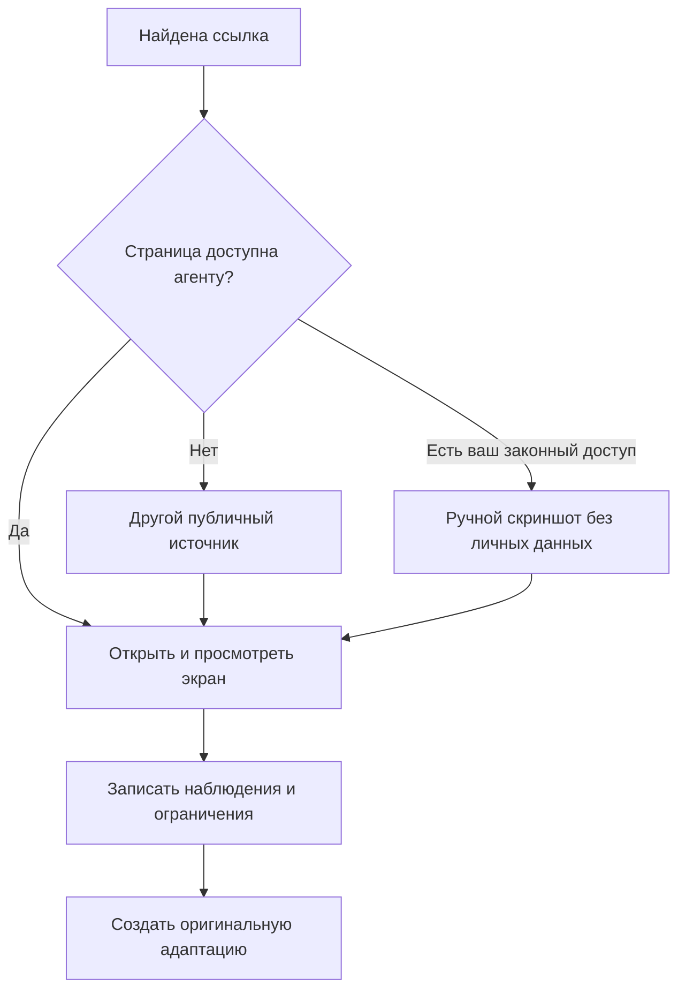

# Поиск референсов без платных библиотек

Цель поиска — найти рабочие решения для конкретной задачи: понятную очередь, удобный просмотр результата, выразительную иерархию или нужный материал. Пять похожих красивых картинок не дают пяти разных решений.

## 1. Разделите вопросы

Сначала запишите, что именно ищете:

| Вопрос | Что искать |
|---|---|
| Как выполнить задачу | Реальные последовательности экранов, демо продукта, документацию |
| Как расположить информацию | Полные рабочие экраны сопоставимой плотности |
| Как оформить компонент | Открытые состояния Select, таблиц, панелей, ошибок |
| Как передать настроение | Дизайнерские концепты, подборки, визуальные исследования |
| Как работает адаптация | Отдельный мобильный экран или реальное изменение ширины |

Не выводите мобильное поведение, анимацию и точные CSS-параметры из одного статичного desktop-скриншота.

## 2. Используйте несколько типов источников

| Источник | Для чего полезен | Что проверить |
|---|---|---|
| Сайты и публичные демо продуктов | Реальные экраны и переходы | Версия, доступность нужного состояния, ограничения демо |
| Документация продукта | Фильтры, действия, модель данных | Относится ли изображение к текущему интерфейсу |
| [Pinterest](https://www.pinterest.com/) | Быстрый поиск визуальных направлений | Перейти от пина к автору или оригинальному продукту |
| [X](https://x.com/) | Работы дизайнеров, детали, видео состояний | Автор, дата, полнота контекста; это может быть концепт |
| [Dribbble](https://dribbble.com/) | Композиция, акценты, выразительные компоненты | Реальные данные и состояния часто не показаны |
| [Behance](https://www.behance.net/) | Серии экранов, кейсы, типографика | Отделить презентационный макет от рабочего экрана |
| Библиотеки компонентов и их демо | API и работа отдельных контролов | Лицензия, версия, совместимость, открытые состояния |
| Собственные скриншоты | Доступные вам закрытые продукты | Удалить личные данные; не публиковать чужие экраны без основания |

Бесплатного аккаунта иногда достаточно для просмотра нужных материалов; это не обещание постоянного бесплатного доступа. Если ресурс требует оплату или вход, выберите другой источник либо передайте разрешенный скриншот вручную. Не обходите ограничения доступа.

Полезные официальные отправные точки: [поиск идей Pinterest](https://help.pinterest.com/en/article/search-for-ideas-on-pinterest), [расширенный поиск X](https://help.x.com/en/using-x/x-advanced-search), [компоненты shadcn](https://ui.shadcn.com/docs), [Apple Human Interface Guidelines](https://developer.apple.com/design/human-interface-guidelines).

## 3. Составьте точные запросы

Сочетайте **задачу + тип экрана + нужный визуальный признак**. Ищите по-русски и по-английски: авторы могут использовать разные термины.

Примеры для CRM:

```text
sales CRM deal review dark table detail panel
CRM next action dashboard lime typography
воронка продаж список сделок карточка клиента интерфейс
```

Примеры для управления агентами:

```text
AI agent run approval interface audit log
workflow execution error recovery dashboard
agent operations console task queue invoice review
```

Примеры для стекла и контроля материала:

```text
dark translucent toolbar popover interface
liquid glass navigation contrast open menu
iOS translucent controls light dark interface
```

В обычном поисковике можно добавить `site:dribbble.com`, `site:behance.net` или название продукта. В X используйте доступные фильтры и расширенный поиск, например запрос `"dashboard" "dark" filter:images`. Публичность записи и ее актуальная доступность проверяются при открытии.

Если выдача состоит из декоративных концептов, измените запрос: добавьте `documentation`, `demo`, `help`, `table`, `settings`, `empty state`, `error`, `mobile`. Ищите недостающую часть сценария, а не еще одну похожую обложку.

## 4. Просмотрите выбранное



Если агент умеет читать только текст страницы, попросите его открыть изображение или передайте снимок. Превью поисковой выдачи, название пина и описание автора не доказывают, что полный интерфейс просмотрен.

Для каждого выбранного источника сохраните короткую карточку:

```text
Источник: прямая ссылка на страницу автора или продукта
Тип: рабочий продукт / концепт / документация / собственный пример
Просмотрено: конкретный экран и состояние
Наблюдение: очередь слева, выбранный документ в широкой центральной области
Оценка: ширина очереди около четверти экрана; точные размеры неизвестны
Адаптация: на телефоне сначала очередь, документ открывается отдельно
Ограничение: мобильный вариант у источника не показан
Использование: приватный визуальный анализ, без включения чужих пикселей в результат
```

В строгом режиме CLI карточка переводится в формат схемы, а просмотренный файл связывается с записью. Свободная заметка выше — понятный человеку пример, не готовый валидный JSON для команды.

## 5. Разберите и переведите в промпт

Разбор должен объяснять решения:

- **Композиция:** что замечают первым и как переходят к действию.
- **Типографика:** роли заголовка, сущности, суммы, подписи и служебного текста.
- **Отступы:** что объединено, что разделено; плотность строк и внешний воздух.
- **Цвет:** основной акцент, фон контента, вторичный текст и смысловые статусы.
- **Компоненты:** почему здесь очередь, там журнал, а здесь панель действия.
- **Материал:** где прозрачность помогает разделить слои, где снижает читаемость.
- **Состояния:** выбранное, открытое, ошибка, ожидание, пустой результат.

Не пишите «сделай современно как на картинке». Пример конкретного перевода:

```text
Сохрани идею трех областей: узкая очередь, широкий документ, компактная история.
Главный акцент — действие над выбранным документом; суммы вторичны.
Типографика: заголовок экрана 30/38, название документа 20/28,
строки 14/20, подписи 12/18. Это предлагаемые размеры, не измерения источника.
Основной контент на плотных темных поверхностях; полупрозрачная только
плавающая навигация. Для открытого меню нужна отдельная читаемая поверхность.
На телефоне очередь первой, документ по нажатию, история после документа.
Сначала сделай один фрагмент с очередью и открытым меню, затем весь экран.
```

## 6. Если нет компонентной библиотеки

Выберите реализацию по задаче, а не по наличию модного названия:

| Доступно | Практический путь |
|---|---|
| Только HTML/CSS/JS | Нативные формы, кнопки, таблицы; собственный визуальный слой |
| Существующий проект | Переиспользовать его реальные компоненты и токены |
| React и разрешение добавить зависимости | Выбрать совместимую библиотеку, проверить версию и документацию |
| Нужен именно shadcn | Следовать [официальной установке](https://ui.shadcn.com/docs/installation), использовать реальные исходники и API |
| Нет права менять зависимости | Предложить совместимый вариант и объяснить ограничение до реализации |

Наличие доступа к поиску shadcn не означает, что компоненты установлены в проекте. Наличие исходника не означает, что проверены зависимости и работа в приложении. Запишите, какие компоненты действительно использованы и что проверено.

Для сложных Select, Dialog и меню готовые доступные примитивы обычно сокращают объем собственной логики. Если их нет, нужно отдельно проверить клавиатуру, Escape, фокус, читаемость открытого состояния и сенсорные размеры.

## 7. Сравнивайте и возвращайтесь к поиску

Покажите источник и актуальный рендер в сопоставимом масштабе. Назовите два-три конкретных расхождения. Исправьте ответственный слой: композицию, шрифт, цвет, компонент или материал.

Возвращайтесь к поиску, если исходник слишком декоративный, не показывает нужного состояния или не подходит по плотности. Увеличение blur не исправит неясную очередь действий.

Сохраняйте паттерн с контекстом: наблюдение → решение → где подходит → где не подходит → что проверено. Не превращайте одну неудачную палитру в запрет цвета для всех будущих проектов.

## Права и публикация

Открытая страница не дает автоматического разрешения распространять ее изображения, код, шрифты и иллюстрации. Разделяйте приватный анализ и публикацию результата. Для публикации используйте свои рендеры, разрешенные ресурсы и соблюдайте условия лицензий; проверяйте условия конкретного источника.

Ссылка и текстовое наблюдение полезнее копии чужого скриншота внутри общего репозитория навыка. Не включайте приватные снимки, учетные данные или переписку в публичный пакет. Удаление файла из последнего коммита не удаляет его из истории Git.
