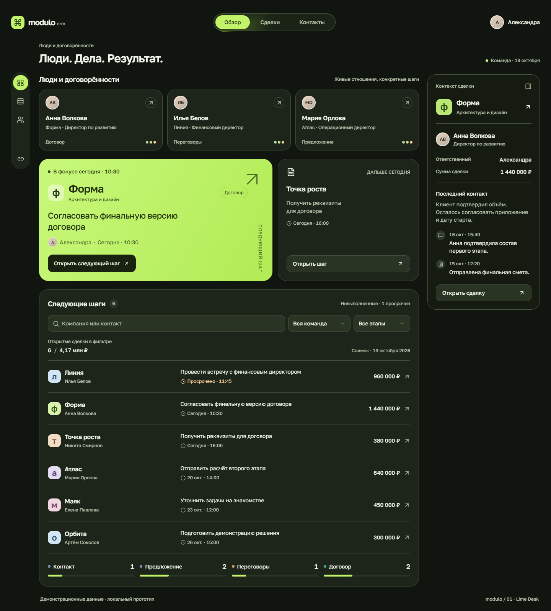
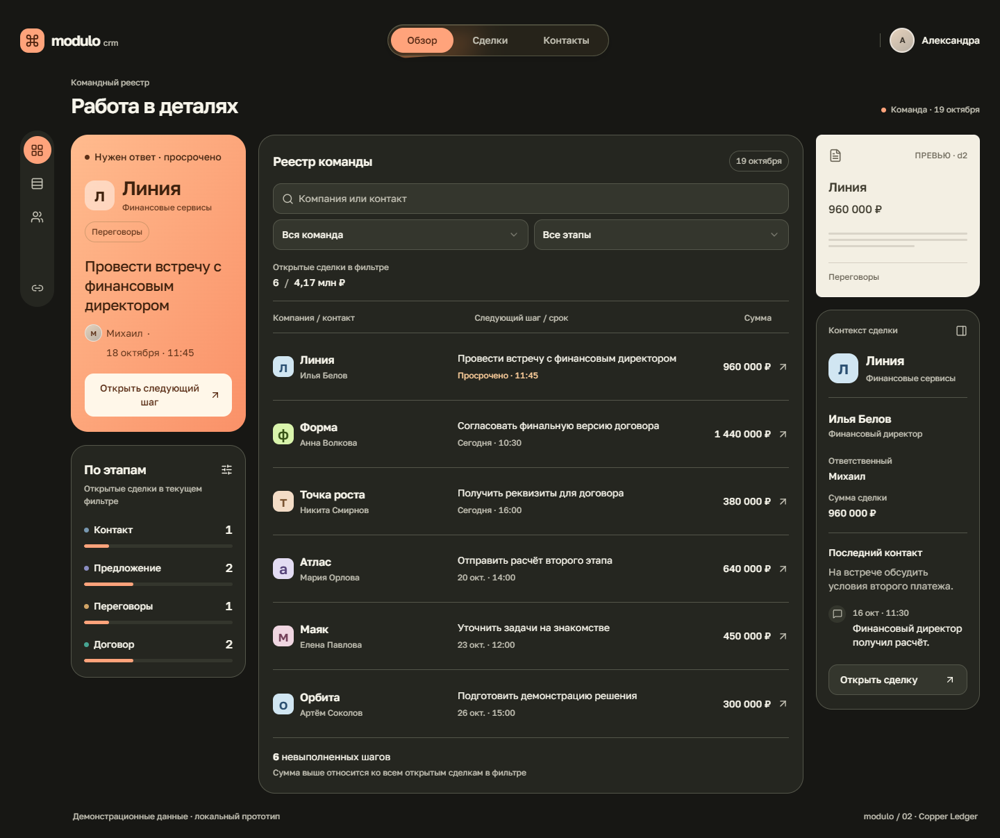
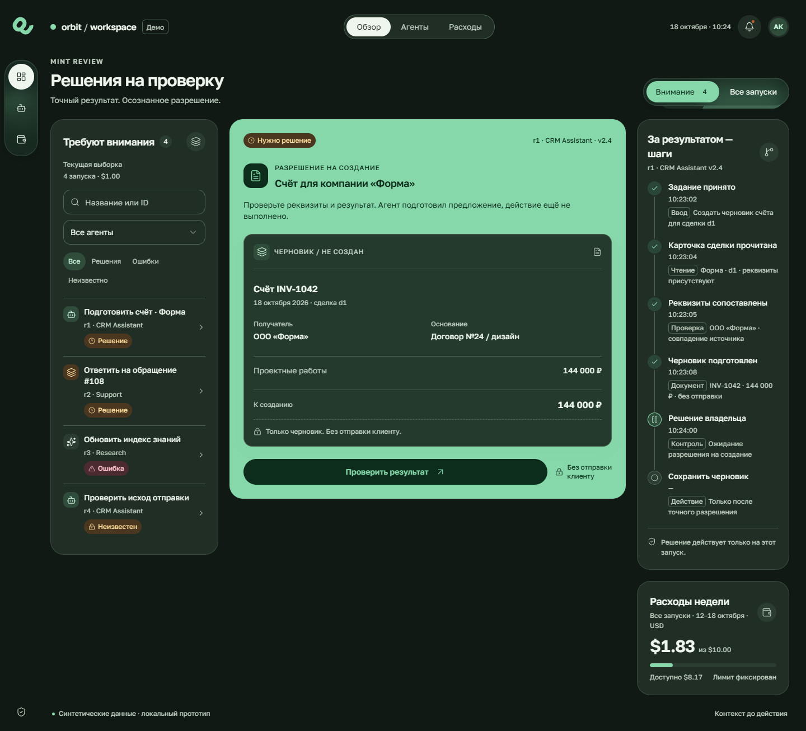
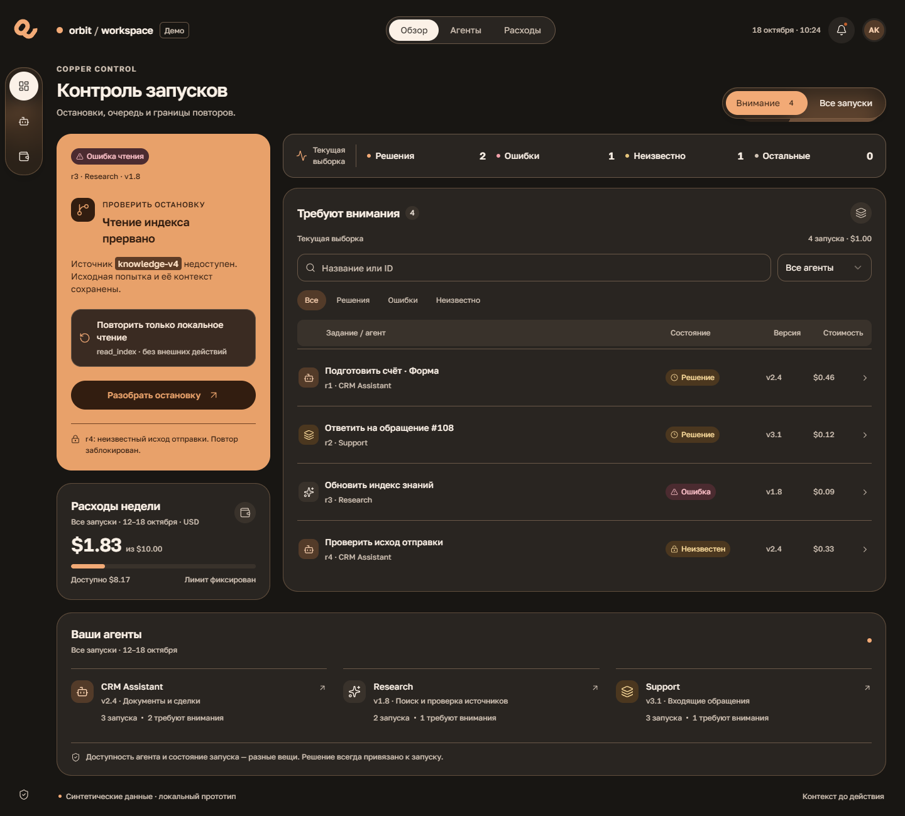

# CRM и управление ИИ-агентами

Четыре авторских направления из более ранних исследований интерфейсов. Здесь опубликованы исходники и свежие PNG их переносимой сборки: desktop 1440 px и полный мобильный экран 390 px. Это синтетические локальные прототипы, не клиентские продукты и не утвержденная дизайн-система.

| Направление | Основная задача | Решение | Компромисс |
|---|---|---|---|
| Lime Desk · CRM | Выполнить следующий шаг по сделке | Заметная лаймовая задача, люди, очередь и контекст выбранной сделки | Сравнение большого количества сделок требует прокрутки |
| Copper Ledger · CRM | Разбирать реестр команды | Оранжевый приоритет слева, широкая таблица, отдельное превью справа | Меньше места для контактов и эмоциональной подачи |
| Mint Review · ИИ | Проверить результат перед разрешением | Документ в центре, очередь слева, предметная трасса справа | Общий мониторинг команды вторичен |
| Copper Control · ИИ | Разобрать остановку запуска | Акцент на ошибке и допустимом повторе, состояния и журнал запусков | Полный документ открывается отдельно |

## Lime Desk · CRM



[Открыть мобильный PNG](images/crm-lime-mobile.png) · [Исходник CRM](app/src/products/crm/CRM.jsx)

## Copper Ledger · CRM



[Открыть мобильный PNG](images/crm-copper-mobile.png)

## Mint Review · ИИ



[Открыть мобильный PNG](images/ai-mint-mobile.png) · [Исходник админки](app/src/products/ai/AI.jsx)

## Copper Control · ИИ



[Открыть мобильный PNG](images/ai-copper-mobile.png)

## Запустить исходники

Для просмотра PNG зависимости не нужны. Для интерактивных примеров нужны Node.js 24 и npm. Из корня репозитория:

```bash
cd examples/showcase/app
npm ci
npm run dev
```

Установка локальная, в папку примера. Этот React-пример использует настоящие shadcn/Radix-компоненты, Tailwind и Lucide; он не выдает похожие нативные кнопки за библиотечную реализацию.

Откройте нужный экран:

- Lime Desk: `http://127.0.0.1:5175/?example=crm-lime`
- Copper Ledger: `http://127.0.0.1:5175/?example=crm-copper`
- Mint Review: `http://127.0.0.1:5175/?example=ai-mint`
- Copper Control: `http://127.0.0.1:5175/?example=ai-copper`

Для сборки и просмотра без dev-сервера, из той же папки:

```bash
npm run build
python -m http.server 4173 --bind 127.0.0.1 --directory dist
```

Те же параметры `?example=...` работают на порту 4173. Открывайте через HTTP. Дополнительные `&mode=components` и `&mode=calibration` показывают состояния компонентов и отдельный фрагмент композиции.

В CRM можно искать сделки, менять фильтры, открывать точную сделку, отменять черновик, сохранять следующий шаг и отменять его завершение. CRM сохраняет только демонстрационные данные в localStorage данного браузера. Админка показывает точный запуск, результат, подтверждение решения и ограниченное локальное восстановление. Внешних действий, отправки документов и настоящих запусков агентов нет.

## Что проверено

Все четыре направления собраны и открыты в настоящем Chrome на двух ширинах. Проверены отсутствие горизонтального переполнения, открытие нужной записи, Escape и возврат фокуса; для CRM — отмена несохраненной заметки. У страниц не было ошибок JavaScript и внешних запросов. PNG просмотрены отдельно. Это не заменяет полный аудит доступности, тесты на физическом телефоне или исследование с людьми.

## Как использовать скилл на этих примерах

```text
Используй Copper Ledger из examples/showcase как авторскую опору.
Сохрани структуру: приоритет → реестр → контекст выбранной сделки.
Сначала разбери типографику, группировку, роли акцента и состояния.
Запиши применимые паттерны, составь конкретный промпт и только затем
адаптируй экран к моим данным. Покажи desktop и mobile PNG,
сравни результат с опорой. Не ограничивайся сменой цвета.
```

Для другого продукта перенесите принцип приоритета и компоненты, а не названия компаний и суммы. Демонстрационные персоны, организации, операции, даты и документы вымышлены; здесь нет пользовательских загрузок, закрытых референсов или переписок.

Авторские интерфейсы и код — [MIT](../../LICENSE). Сохраненные компоненты shadcn/ui — [MIT с исходным уведомлением](app/SHADCN-LICENSE.md). Golos Text — [SIL Open Font License 1.1](app/public/fonts/GolosText-OFL.txt); шрифт хранится локально. Лицензии установленных npm-зависимостей остаются частью этих пакетов. Сборка `dist` и `node_modules` в распространяемый навык не входят.
